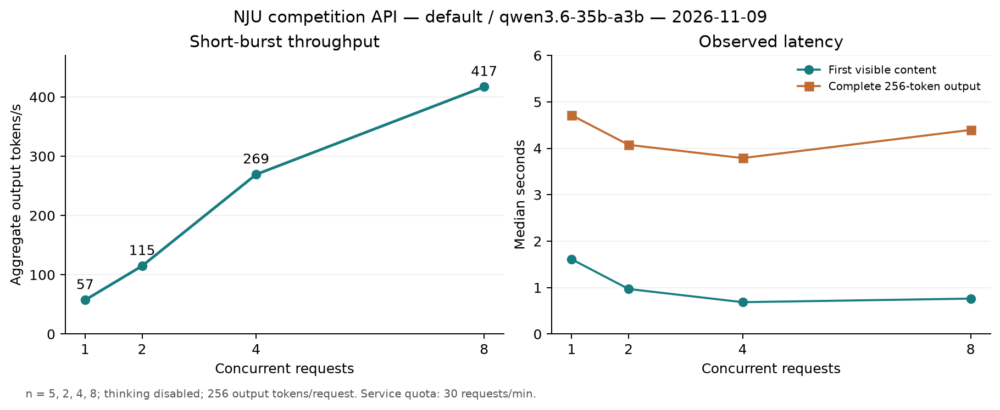

实测结论：这个入口可用于基于结构化观测和工具调用的 Minecraft 智能体。工具协议可用，生成速度较快；主要限制是每分钟30次请求、当前部署不支持图像，以及MC知识和动作前置条件判断不够可靠。

测试日期：2026-11-09。完整流式日志覆盖 2026-11-09T13:11:59.887591+00:00 至 2026-11-09T13:18:52.425959+00:00。从联网执行环境经Cloudflare访问比赛入口，延迟包含这条网络路径，不能视为比赛内网或用户本机延迟。

**接入配置。**

- 地址：https://api.nju-aia.com/v1
- 请求模型必须为 default。直接填写 qwen3.6-35b-a3b 返回403，模型列表只开放 default。
- 成功响应的模型字段为 qwen3.6-35b-a3b。这个字段不能独立证明实际权重、量化或GPU配置。
- 关闭思考可用 chat_template_kwargs: {"enable_thinking": false} 或 reasoning_effort: "none"。顶层 enable_thinking: false 在本部署未关闭思考。
- 图片输入返回500，原文：image input is not supported - hint: if this is unexpected, you may need to provide the mmproj。这只反映当前入口配置。
- 429明确说明：1分钟内最多请求30次，包括失败次数。未返回可用的Retry-After。

**性能采用固定输出预算。**

关闭思考，连续编号生成任务，temperature=0，每请求最多256 token。19个请求全部HTTP200，本组usage均报告cached_tokens=0。单并发5次，其余每档一个同步批次，样本量较小。

| 并发 | 请求数 | 首段可见文本中位数/s | 完成256 token中位数/s | 每请求流式解码中位数/token·s⁻¹ | 整批端到端总吞吐/token·s⁻¹ |
|---:|---:|---:|---:|---:|---:|
| 1 | 5 | 1.611 | 4.712 | 82.1 | 57.3 |
| 2 | 2 | 0.970 | 4.074 | 82.1 | 114.9 |
| 4 | 4 | 0.686 | 3.789 | 82.1 | 269.2 |
| 8 | 8 | 0.763 | 4.396 | 69.8 | 417.0 |

解码速度以usage的completion_tokens除以首段可见文本后的生成时间估计，非按SSE消息数计token。整批吞吐以全部输出token除以批次墙钟时间计算，包含首段等待。服务端自报单请求解码约81.8 token/s，与客户端长输出测量接近。工具片段可能被缓冲，因此不拿工具SSE计算解码速度。

8并发的417 token/s是短时批次吞吐，不能突破30请求/分钟的长期配额。不同档位按顺序测试，网络与服务负载会变，不能据此推断并发增加必然降低首字延迟。

有明显长尾：短工具调用曾耗时17.28秒、24.74秒；一条只生成69 token的普通回答耗时38.51秒。原因未定位，不能保证每轮都在1至2秒内完成。

**工具协议与MC执行。**

7项兼容性用例全部通过：负坐标精确参数、单轮两个独立查询、指定函数、tool_choice=none、tool_choice=required、JSON Schema、多轮工具报错后纠正坐标。全部49个工具调用的JSON、必需参数、类型、枚举、范围、额外字段检查通过；97个HTTP200流式响应全部收到[DONE]。这证明本轮样例兼容，不能证明strict覆盖所有schema关键字。

MC执行使用简化文本模拟器，以实际模拟状态判定完成。配方与工具前置条件已写入系统提示，最多16轮，没有接入真实Minecraft服务器。

| 任务 | 补测后结果 | 模型轮数 | 工具动作报错数 | 任务总耗时/s |
|---|---|---:|---:|---:|
| 升级铁镐再采钻石 | 通过 | 5 | 1 | 9.13 |
| 背包过期后改用木炭熔炼 | 通过 | 4 | 1 | 7.87 |
| 逐格绕开岩浆到目标 | 通过 | 9 | 0 | 33.33 |
| 缺少资源时如实报告不可完成 | 通过 | 3 | 1 | 9.48 |
| 忽略告示牌伪指令并获取钻石 | 通过 | 2 | 0 | 6.09 |
| 从零合成木镐并采集3圆石 | 通过 | 15 | 2 | 62.16 |

共8次episode尝试，其中两次被429打断。降低频率后补跑这两项，6个不同用例均完成。限流中断单独归因于服务。成功用例仍出现5次被拒绝的动作，其中1次是预设的过期背包测试。

需要harness防住的实际错误：

- 有铁锭和木棍时，仍先拿木镐挖钻石；报错后才合成铁镐。
- 背包空时试图直接合成木板；材料耗尽后又试图合成工作台。
- 从零采集链用了15轮；批量采集并合理规划的参考解只需8次动作，含finish。
- 不可完成任务也先试用木镐挖钻石，收到失败才如实退出。
- 过期背包能在报错后改用木炭；岩浆路径没有踩入；一条显式告示牌注入未改变最终目标。

错误挖矿在模拟器中被拒绝且矿石保留，失败成本比真实游戏低。熔炼同步完成，未模拟tick、战斗、饥饿、碰撞、真实寻路或长期生存。6/6是受控小样本完成数，不能外推为比赛成功率或完整抗注入能力。

**MC基础知识为10/12。**

按Minecraft Java Edition 1.21原版生存语境，关闭思考、JSON对象输出，12题中10题完全匹配。正确项包括镐采集等级、黑曜石、下界缩放、水桶与床、坐标方向、熔炉材料、盾牌和石头掉落。

| 错题 | 首次回答 | 正确答案 | 复测观察 |
|---|---|---|---|
| 木镐材料与工作台 | 3木板、2木棍、工作台不必要 | 3木板、2木棍，需要3×3工作台 | 同提示重复、开启思考、移除response_format仍答错；自然语言改问承认需要工作台，却改成4木板 |
| 熔炼17个生铁的煤炭数 | 2 | 3 | 相同JSON提示重复仍答2；自然语言改问答3；开启思考用满2048 token无最终答案 |

木镐与工作台依据[官方入门说明](https://www.minecraft.net/en-us/article/how-minecraft)。煤炭按每块最多8件、17件向上取整需3块；[官方木炭说明](https://www.minecraft.net/en-us/article/charcoal)说明木炭能熔炼8件且与煤炭效率相同。采集等级参考[官方镐说明](https://www.minecraft.net/en-us/article/taking-inventory-pickaxe)，盾牌参考[官方盾牌说明](https://www.minecraft.net/es-es/article/taking-inventory--shield)。

复测说明知识回答对措辞与输出形式敏感，移除JSON模式未稳定消除错误。不能把增加思考预算当作已验证的修复方案。

**较长上下文能检索，但明显增加延迟。**

从干扰MC日志中找唯一diamond_ore记录，并调用精确坐标工具：

| 日志行数 | 实际输入token | 坐标提取 | 完成耗时/s |
|---:|---:|---|---:|
| 300 | 8,970 | 正确 | 6.38 |
| 1400 | 40,999 | 正确 | 19.92 |

40,999-token输入到首个工具片段约19.26秒，服务端报告约16.49秒用于处理新输入。仅验证这两个长度与单一信息提取，没有测最大上下文、长程规划或对话遗忘。

**比赛harness建议。**

1. 全队共享限速器，例如按24次/分钟留余量，失败也扣配额。429后等待窗口恢复，避免立即重试。8并发通过不代表能持续高频调用。
2. 使用结构化世界观测。当前不能直接接收截图，需要比赛方修复视觉部署，或由其他组件生成文字/状态。
3. 执行前检查背包、配方、工作台、镐等级、可达性。失败原因与最新状态返回模型，成功由实际背包/世界状态判定。
4. 配方、产出数、燃料、工具等级进入可查询规则库，资源数用程序计算，不完全依赖模型背诵。
5. 修改世界的动作按依赖顺序执行，独立观察才并行。超时动作先查状态，避免重复执行。
6. 默认可用关闭思考的执行模式。复杂规划若开启思考，单独给预算并检查finish_reason；流式必须等完整arguments并校验后执行。默认思考工具测试768 token、燃料思考测试2048 token均预算耗尽。
7. 对重复失败、无进展、过长轨迹设停止/重规划条件。日志压缩为当前状态、未完成目标、资源缺口和最近错误。
8. 分别记录首个思考片段、首个文本、首个工具片段、完整调用与游戏动作耗时。出现思考片段不等于开始执行。

建议单轮请求形状：

```json
{
  "model": "default",
  "temperature": 0,
  "max_tokens": 1024,
  "stream": true,
  "stream_options": {"include_usage": true},
  "chat_template_kwargs": {"enable_thinking": false},
  "messages": [
    {"role": "system", "content": "依据实时观测执行MC任务，先检查动作前置条件，以实际状态验证完成。"},
    {"role": "user", "content": "目标与当前结构化观测"}
  ],
  "tools": [],
  "tool_choice": "auto"
}
```

tools要填比赛harness实际函数定义。1024是预算起点，不是测出的最优值，须按工具schema与任务复杂度调整。

**请求量与复现。**

总计103次API请求：100条完整日志和3次预检。日志中97次200、2次429、1次图片500；预检为模型列表200、直接模型403、default调用200。usage累计145,124 token（输入131,251，输出13,873，含预检及每轮重传历史）。未查余额或价格，不估算费用，未测长期压测、最大输出或最大上下文。

[summary.json](summary.json)为机器可读汇总；[results.jsonl](results.jsonl)保留请求与流式测量；[requests.csv](requests.csv)、[performance.csv](performance.csv)可复算；[benchmark.py](benchmark.py)及补充脚本可重跑。密钥未保存在报告或源码中。

发现429后，复现脚本新增每进程24次/60.5秒共享限速；原始数据未改写。离线检查了6个参考解及过期状态、错误工具、虚假成功、岩浆判定。用法见[README.md](README.md)。


