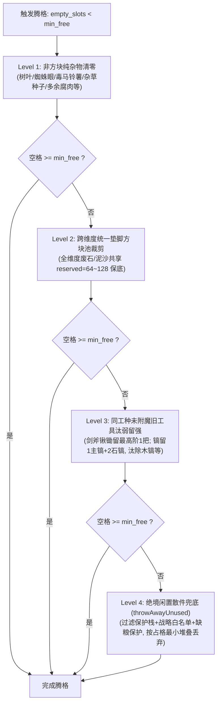

# L3 主子协同控制、容器记忆自愈与 AltoClef 物品栏管理系统设计阐述

> 日期：2026-11-18  
> 状态：架构与机制设计阐述（供审阅与任务分发，未直接修改运行代码）  
> 关联工作区：主仓 `/home/xzq/projects/mc` 与隔离分支 `/home/xzq/projects/mc/.worktrees/l3-sched`（`feat/l3-scheduler`）

---

## 1. 背景与实机轨迹暴露的四条核心断层

基于 2026-11-18 最新完成的实机轨迹审计——包括 Phase A 确定性备料验证（[l3-scheduler-live-20261118-180750.json](file:///home/xzq/projects/mc/.worktrees/l3-sched/runs/l3-scheduler-live-20261118-180750.json)）、Phase B 带记忆多集课程（[curriculum-20261118-185910-417116.json](file:///home/xzq/projects/mc/.worktrees/l3-sched/runs/curriculum-20261118-185910-417116.json)，11 分钟 60 分）以及 Phase C 36 分钟无布景野生压测（[curriculum-20261118-191042-706198.json](file:///home/xzq/projects/mc/.worktrees/l3-sched/runs/curriculum-20261118-191042-706198.json)）——当前系统在**主子进程协同、容器记忆同步、前置粒度与背包全生命周期管理**四个环节存在明确的结构性短板：

1. **子任务盲跑与主进程失控（对应议题 #2）**：
   - 在野生压测第 4 集（[l3-wild-20261118.log](file:///home/xzq/projects/mc/.worktrees/l3-sched/runs/l3-wild-20261118.log#L171-L242)），子任务在 `@50.1s`（第 3 次工具调用）已合出 `iron_pickaxe` 并解锁 `story/iron_tools`；但主进程 `CurriculumSupervisor` 在 `run_mc_agent` 运行期间既无轮间状态感知，也无主动收束/暂停手段，导致模型自行发散下井乱挖 421 秒直至超时，并把唯一一把铁镐磨碎。
2. **容器记忆读写时序与异常自愈断层（对应议题 #3）**：
   - 在 [20261118-185946-916602.json](file:///home/xzq/projects/mc/.worktrees/l3-sched/runs/20261118-185946-916602.json) 中，开局 `pre_ensure` 已将箱内唯一的 `redstone×1` 取出并合好磁石与指南针，但 `select_next_target` 在 `pre_ensure` **之前**就将旧 `[仓储提示]` 烘焙进了任务字符串；同时 [`library.py`](file:///home/xzq/projects/mc/.worktrees/l3-sched/src/mc_agent/skills/library.py#L3406-L3413) 在 `window/act` 抛出 `ApiError("missing_item")` 时未将错误附带的最新空箱快照写回 `WorldMemory`，导致模型连撞 3 次空箱、白耗 22 轮。
3. **0-LLM 前置越界承担地下探矿（对应议题 #4）**：
   - `bootstrap_iron_age` 将 `iron_pickaxe` 放入 `pre_ensure` 并将时间片放大到 `300s`（[`curriculum.py`](file:///home/xzq/projects/mc/.worktrees/l3-sched/src/mc_agent/harness/curriculum.py#L1110)），在无露头铁矿的野生地形中耗尽时间片且缺乏主循环的动态生存策略。
4. **物品栏管理停留在静态丢石表，缺乏任务保护栈、旧工具汰除与归仓闭环**：
   - 现有 [`_ensure_free_slots`](file:///home/xzq/projects/mc/.worktrees/l3-sched/src/mc_agent/skills/library.py#L1129-L1236) 仅处理几种主世界废石，既不敢动淘汰的 `wooden_pickaxe` / 冗余低耐久工具（野生局背包同时塞着木镐 + 2 石镐 + 铁镐占 4 格），也无任务上下文材料保护与基地箱自动归仓。

下文依次阐述这四个模块的完整设计方案。

---

## 2. 模块一：子任务实时反馈与主进程暂停/收束协议（议题 #2）

### 2.1 设计目标

将原本 `CurriculumSupervisor -> run_mc_agent` 的**“黑盒阻塞调用”**升级为**“每轮工具落地的双向协同闭环”**：子任务每完成一轮工具动作后向主进程推送结构化进展帧；主进程据此实时作出 **继续（Continue）/ 达标收束（Complete）/ 挂起抢占（Pause）/ 止损中止（Abort）** 四种裁决，而无需消耗额外一次 LLM 请求去“让模型自己说结束”。

### 2.2 控制流与挂载切口

最佳切口位于 [`agent.py`](file:///home/xzq/projects/mc/.worktrees/l3-sched/src/mc_agent/harness/agent.py#L1284-L1305) 的 `after_tools` 边界——即 `ToolScheduler.run(calls)` 与 `capture_notable_events()` 刚执行完毕、下一轮 `chat_fn` 请求尚未发出之前：

```mermaid
sequenceDiagram
    participant Sup as CurriculumSupervisor (主进程)
    participant Loop as run_mc_agent (子任务循环)
    participant Bot as BotSession / WorldMemory

    Sup->>Loop: 启动子任务 (target, budget, episode_gate 回调)
    loop 每一轮 Actor 工具迭代
        Loop->>Bot: ToolScheduler 执行工具并更新 WorldMemory / 事件游标
        Bot-->>Loop: 最新 status, inventory, notable_events
        Loop->>Sup: on_step_feedback(EpisodeFeedback 快照)
        alt 目标进度已解锁 / 基建目标物已入包
            Sup-->>Loop: Directive(action="complete", reason="goal_satisfied")
            Loop-->>Sup: 立即正常返回 report(status="goal_satisfied")
        else 扫到高优突发机会 (如发现村民/岩浆池/天黑近床)
            Sup-->>Loop: Directive(action="pause", reason="preempt_opportunity")
            Sup->>Sup: 压入 SuspendedEpisode 栈，插队执行短平快目标
            Loop-->>Sup: 返回 report(status="paused", resume_state=...)
        else 偏航但可纠偏
            Sup-->>Loop: Directive(action="continue", runtime_note="纠偏提示")
        else 正常推进
            Sup-->>Loop: Directive(action="continue")
        end
    end
```

### 2.3 核心契约定义

1. **子任务上报帧 `EpisodeFeedback`（0 额外 HTTP 开销优先，仅在关键工具后按需补查）**：
   - `episode_step: int`、`elapsed_s: float`、`actor_requests: int`；
   - `last_tools: list[tuple[str, dict, dict]]`（本轮调用的工具名、参数及解析后的 JSON 结果摘要）；
   - `status_cached: dict`（复用 `toolset` 刚更新的位置、血量、维度、昼夜缓存）；
   - `inventory_counts: dict[str, int]`（当本轮工具涉及 `craft` / `smelt` / `mine` / `container` / `pickup` 时附带最新背包与穿戴计数）；
   - `newly_unlocked_advancements: set[str]`（从 `capture_notable_events` 或合成/交互成功后的轻量 `advancements` 校验获得）；
   - `new_memory_discoveries: list[str]`（本轮 `WorldMemory` 新入库的稀缺地标/生物聚落，如首次发现 `villager`、`lava`、`bed`、`blaze`）。

2. **主进程裁决指令 `SupervisorDirective`**：
   - `CONTINUE`：继续下一轮推理；若附带 `runtime_note`，以同位覆盖方式注入单条 `[主控调度提示]`，避免刷屏污染上下文。
   - `COMPLETE`：**达标即刻短路**。判定条件由目标对象自身的客观谓词 `target.is_satisfied(completed_advs, inv_counts)` 决定：
     - 普通成就目标：`target.advancement_id in completed_advs`（注：`shiny_gear` 钻石套餐例外——首 4 钻穿靴锁住 75 分后，允许在镐耐久与时间充裕时继续顺采至套餐上限再收束）；
     - 基建目标：`bootstrap_stone_age` 满足 `pick_tier >= 2`；`bootstrap_iron_age` 满足 `iron_pickaxe >= 1`（一旦在第 50s 合出铁镐，当场 `COMPLETE` 切入下一集，杜绝后续乱挖耗碎铁镐）。
   - `PAUSE`：**挂起与抢占恢复机制**。
     - 当子任务正在跑长周期 `deep` / `expedition` 目标（如远航或初期探图），反馈帧报告 `WorldMemory` 刚在 `<= 32m` 内新发现高分 Tier-1 机会（例如路过村庄扫到 `villager` + 箱内绿宝石可 7 轮拿 `adventure/trade` 15 分，或路过静止岩浆池且包内有铁桶可 4 轮拿 `lava_bucket` 15 分）：
     - 主进程下发 `PAUSE`，将原任务保存至单层挂起槽 `suspended_target`（记录剩余预算、挂起前坐标与矿井锚点），优先跑完 `micro/short` 突发高分支线后，再自动恢复原任务。
   - `ABORT`：**物理失能止损**。若子任务途中因死亡丢失前置核心工具（例如在 `shiny_gear` 深潜中死亡丢失全部 `iron_pickaxe` 且包内无铁锭），主进程不等 40 轮耗尽，立即 `ABORT` 回退至 `bootstrap_iron_age` 重备铁镐。

### 2.4 扩展能力：前后台异步世界工单（`WorldJobRegistry` —— 解决熔炉/酿造原地罚站）

在单 Bot 互斥动作锁架构下，Bot 同一时刻只能执行一个身体动作，但**服务端方块实体（熔炉、高炉、烟熏炉、酿造台、篝火）依靠世界 Tick 独立推进，不占用 Bot 动作锁**。依托 `2.2–2.3` 的 `PAUSE / RESUME` 协议，可将原本在 `smelt_items` / `brew_once` 中阻塞 `sleep` 罚站的等待期升级为前后台并行：

1. **盈亏比门禁与多炉并联压缩**：
   - **小单原地完成（`预计等待 < 45s`，如烧 `1~4` 块粗铁合首把铁镐）**：保持原地同步等待，但利用等待的 `20~30s` 窗口在本地 0-LLM 顺手执行穿戴护甲（`AutoEquip`）、清杂腾格与木棍/工作台预备，省去往返寻路与额外 LLM 轮次开销。
   - **中大单双炉并联 + 切后台（`预计等待 >= 45s`，如烧 12 块 `stone` 合磁石、烧 16+ 铁锭、两段酿造药水）**：
     - 若背包 `cobblestone >= 16`（或附近已有多个熔炉）且待烧数量 `>= 8`，优先 0-LLM 并排放置 `2~3` 台熔炉均分原料与燃料，将物理耗时直接压缩 `50%~66%`；
     - 投料点火后立即算出确定性完成时刻 `ready_at = now + per_item_s * max_per_furnace`，向 `WorldJobRegistry` 注册后台工单 `WorldJob(kind="furnace"|"brewing", dim, pos, output_item, count, ready_at)` 并立即返回。
2. **挂起切换与 `80m` 区块保活电子拴绳（Simulation Distance Leash）**：
   - **原版物理硬红线**：Minecraft 服务端仅对玩家周围模拟距离（通常 `6~10` 区块，即 `96~160` 格）内的方块实体执行 Tick；若 Bot 在燃烧期间跑远或跨维度，熔炉所在区块会被卸载冻结。
   - **调度策略**：当前依赖熔炼产物的任务以 `PAUSE (waiting_for_job=job_id)` 挂起；在 `[now, ready_at]` 窗口内，主进程自动给前台填充任务施加一条**以工单坐标为圆心、半径 `80m`、同维度的软围栏（Leash）**，仅挑选围栏内可达的短任务或基地整备动作（砍树补木、箱子归仓、绑床、附近村民交易、狩猎动物攒粮）。
3. **到点收菜与自动唤醒**：
   - 每轮 `after_tools` 回调检测到 `now >= job.ready_at` 时，主进程暂存当前填充动作，导航回 `job.pos` 执行单步 `window/act(take output)` 收取产物、销账工单，并自动唤醒（Resume）原先挂起的主线任务。

---

## 3. 模块二：容器记忆一致性闭环与提示重算（议题 #3）

### 3.1 根因拆解

实机轨迹证明，容器幻觉并非单一 Bug，而是**“写入端漏处理失败回执”**与**“读取端过早固化提示词”**共同导致的缓存失步：

| 断层位置 | 现状行为 | 实机后果 |
|---|---|---|
| **写入端 A**：[`library.py`](file:///home/xzq/projects/mc/.worktrees/l3-sched/src/mc_agent/skills/library.py#L3406-L3413) `container_batch` | 仅在 `window/act` 完全成功时调 `_sync_container_window`；进入 `except ApiError`（如 `missing_item` 或部分操作成功后中断）时直接返回 | 服务端在错误详情 `err.details["window"]` 中已经带回了箱子当前真实的剩余物品列表，但客户端直接丢弃，导致 `WorldMemory` 永远停留在旧快照 |
| **写入端 B**：[`world_memory.py`](file:///home/xzq/projects/mc/.worktrees/l3-sched/src/mc_agent/harness/world_memory.py#L650-L685) | 若箱子方块本身已被挖掉或距离过近却寻路/打开失败，缺少像 AltoClef `ContainerSubTracker.isContainerCacheValid` 那样的方块存活性核销 | 已拆毁箱子的幽灵库存残留在记忆中 |
| **读取端 C**：[`curriculum.py`](file:///home/xzq/projects/mc/.worktrees/l3-sched/src/mc_agent/harness/curriculum.py#L1059-L1155) | 先调 `select_next_target` 把 `[仓储提示：取 redstone×1]` 拼入 `target.task`，后调 `pre_ensure` 从箱中取空红石并合出成品，最后仍把旧 `target.task` 传给模型 | 模型同时看到“成品已入包”和“请去箱子取红石从头烧石头合磁石”两条自相矛盾的指令，被后者带偏空转 22 轮 |

### 3.2 闭环修复方案

1. **全路径窗口快照强制覆写（对标 AltoClef `ContainerSubTracker`）**：
   - 在 `mc_window_view`、`mc_window_act` 与 `container_batch` 的**正常分支与 `ApiError` 异常分支**统一提取 `window` 载荷：只要响应或错误详情中携带了容器 `sections.container` 槽位数组，立即调用 `world_memory.update_container_from_window(...)` 覆写该坐标的库存字典（空箱写入 `{}`，彻底清除已取走条目）。
   - 当对已知容器坐标执行 `window/view` 或 `get_block` 发现目标方块已变为 `air` 或非容器方块时，立即从 `WorldMemory.containers` 与 `pois` 双表联动销账。
2. **选标与终态 Prompt 解耦渲染**：
   - `CurriculumTarget` 新增精简字段 `post_ensure_task: str | None`（描述“当前置成品已在背包时的纯放置/交互终局动作”）；
   - `select_next_target` 只返回纯净的选中目标元信息（不预先焊死 `[仓储提示]` 字符串）；
   - 等 `pre_ensure` 执行完毕后，再基于**取物/合成后的最新背包与最新 `WorldMemory.containers`** 动态生成 `eff_task`：
     - 若 `pre_ensure` 已 `ok=True` 备齐全部前置物品：直接使用 `post_ensure_task`（如 `use_lodestone` 仅下达：“背包已有 `lodestone×1` 与 `compass×1`，在身旁实心地面放置 `lodestone` 后手持 `compass` 调 `mc_interact` 绑定即可”），**不再拼接从零烧石头的合成说明与已过期的取物提示**；
     - 若 `pre_ensure` 部分完成转交模型：基于最新 `WorldMemory` 重新计算一次 `_build_storage_hint`，仅提示箱内**此刻仍然存在且背包仍缺**的物资。

---

## 4. 模块三：客观镐级硬前置收敛（议题 #4）

### 4.1 职责切分准则

> [!IMPORTANT]
> **硬边界**：0-LLM `ensure_items` 负责**配方树确定性展开、附近箱子提货、熔炼与地表可直采基础原料（原木/圆石）**；凡涉及地下未知矿脉搜索（铁、金、红石、青金石、钻石、远古残骸），`pre_ensure` **只保最低客观工具等级**，绝不在无 `MiningDFS` 和无完整主循环监控的情况下盲目超时搜矿。

### 4.2 各阶段前置映射表

| 目标类型 / 示例 | `pre_ensure` 客观硬前置 | 时间片上限 `pre_slice_s` | 说明 |
|---|---|---|---|
| **石器基建** (`bootstrap_stone_age`) | `("stone_pickaxe", 1)` | `<= 90s` | 地表砍树 -> 工作台 -> 木镐 -> 挖圆石 -> 合石镐全确定性，实测 0-LLM 16 步直通 |
| **铁器基建 / 铁层探矿** (`bootstrap_iron_age`) | **`("stone_pickaxe", 1)`**（除非包+箱已有够用的 `raw_iron`/`iron_ingot` 才顺手直接炼出铁镐） | `<= 75s` | 若无现成铁料，保住石镐后立即交由主循环调 `fishbone_scan(target="iron", target_y=16)` 探铁 |
| **深层钻石套餐 / 红石金矿** (`shiny_gear`) | **`("iron_pickaxe", 1), ("stone_pickaxe", 1)`** | `<= 90s` | 仅用已有/箱存铁料保底主铁镐 + 岩层消耗石镐；若缺铁则由选标器自然先选 `bootstrap_iron_age` |
| **黑曜石采集** (`form_obsidian` 挖取路线) | `("diamond_pickaxe", 1)`（或走 `bucket` 浇筑路线保 `("bucket", 1)`） | `<= 60s` | 严格对应原版 Tier 4 硬门槛或桶配方 |
| **纯合成/交互类成就** (`use_lodestone`, `obtain_armor`, `crafters_crafting_crafters`) | 对应目标成品（如 `lodestone + compass`） | `<= 180s` | 仅在 `accessible_counts` 已具备矿锭核心料（只差砍木/挖圆石/烧石/合成）时跑完整链，缺矿秒返 `requires_world_hunt` |

---

## 5. 模块四：复用 AltoClef 的物品栏与仓储管理系统设计

通过对 AltoClef 官方源码（`BotBehaviour.java`、`Settings.java`、`ItemHelper.java`、`StorageHelper.java`、`EnsureFreeInventorySlotTask.java`、`ItemStorageTracker.java`、`ContainerSubTracker.java`、`StoreInAnyContainerTask.java`）的逐文件拆解，其设计可归纳为 **“一个保护栈 + 一个四级垃圾裁决器 + 一套装备升阶器 + 一套双视图仓储归仓器”**。

### 5.1 AltoClef 组件与 `mc-agent` 映射总览

| AltoClef 原版模块 | 原版核心职责 | 在 `mc-agent` 中的复用策略与简化点 |
|---|---|---|
| `CursorSlot` / `ClickSlotTask` / `ThrowCursorTask` | 处理客户端 GUI 鼠标悬空物品防丢失与槽位点击序号换算 | **100% 省去（无需编写）**：`mc-agent-api` 原生提供原子级 `/drop`、`/equip`、`/craft` 与 `/window/act`，不存在鼠标悬空态 |
| `BotBehaviour.protectedItems` (`push` / `pop`) | 任务生命周期内动态保护当前配方链原料与工具不被当作垃圾或燃料消耗 | **100% 原样复用**：实现为栈式上下文管理器 `with inv_mgr.protect(items):` |
| `Settings.importantItems` / `supportedFuels` | 永不丢弃的高价值战略物资白名单；锁死安全熔炉燃料防止误烧床/木工具/烈焰棒 | **100% 复用并扩充 1.21.11 99 项成就关键物**（补入锻造模板、紫水晶、潜影壳、唱片等） |
| `StorageHelper.getGarbageSlot` | 按「非方块垃圾 -> 超额建筑废石 -> 低阶冗余工具 -> 非重要低量散件（带饥饿度保护）」四级挑出最该腾退的槽位 | **95% 核心逻辑复用**，仅将“同工种只留 1 把最高阶镐”微调为适配鱼骨挖矿的「1 主镐 + 最多 2 石镐」双层配额 |
| `EquipArmorTask` | 自动穿戴更高护甲值装备与副手盾牌，既涨护甲又腾背包格 | **100% 复用**（额外保留下界维度 1 件金甲防猪灵敌对） |
| `ItemStorageTracker` + `StoreInAnyContainerTask` | 严格区分 `InventoryOnly`（终局验真）与 `Container`（备料提货）；包满或远征前将非当前所需的贵重物存入基地箱（无箱自动造箱放置，避开地牢箱与上方压盖方块） | **90% 复用**，直接对接 `WorldMemory.containers` 与 `container_deposit` |

### 5.2 核心子机制一：栈式动态保护表（`ProtectionStack`）

为解决“静态垃圾表在特定任务下误丢原料（如合磁石时丢圆石、做泥砖时丢泥土、搭桥时丢垫脚石）”以及“熔炉乱烧木制品”的问题，复刻 AltoClef `BotBehaviour` 的栈式保护模型：

1. **三层合并保护判据 `is_protected(item_row)`**：满足任一条件即禁止丢弃、禁止降级消耗：
   - **动态栈帧层**：位于当前栈顶活跃集合 `active_protected_items` 中。每当 `CurriculumSupervisor` 启动某集目标或 `ensure_items` 递归展开某物品的配方树时，自动将该目标及其所有下级原料压栈，退出时自动弹栈恢复。
   - **全局战略白名单 `IMPORTANT_ITEMS`**：
     - 高阶矿产与锭块：`diamond*`、`netherite*`、`ancient_debris`、`emerald*`、`iron_ingot`、`raw_iron`、`iron_block`、`gold_ingot`、`raw_gold`、`gold_block`、`lapis_lazuli`、`redstone`、`quartz`、`amethyst_shard`；
     - 跨维度与通关核心：`ender_pearl`、`ender_eye`、`blaze_rod`、`blaze_powder`、`ghast_tear`、`nether_wart`、`obsidian`、`crying_obsidian`、`glowstone_dust`、`dragon_breath`、`shulker_shell`、`*shulker_box`、`totem_of_undying`、`enchanted_golden_apple`、`golden_apple`、`trident`、`heavy_core`、`breeze_rod`；
     - 99 项成就稀缺件：`*_smithing_template`、`enchanted_book`、`name_tag`、`saddle`、`lead`、`goat_horn`、`spyglass`、`brush`、`music_disc_*`、`glow_ink_sac`、`honey_bottle`、`honeycomb`、`turtle_scute`、`armadillo_scute`、`wolf_armor`；
     - 生存核心器具：`*bucket`（铁桶/水桶/岩浆桶/奶桶/粉雪桶/鱼桶）、`crafting_table`、`furnace`、`enchanting_table`、`anvil`、`brewing_stand`、`*_bed`、`shield`、`bow`、`crossbow`、`flint_and_steel`、`shears`、`compass`、`lodestone`。
   - **实例属性层**：`enchantments` 非空、或 `custom_name` 非空的任何物品实例（无论材质高低）永久保护。
2. **安全燃料门禁 `SUPPORTED_FUELS`**：
   - 复刻 AltoClef `limitFuelsToSupportedFuels = true`，熔炉自动选燃料只允许使用 `coal`、`charcoal`、`blaze_rod`（仅在富余且非保护时禁烧，默认不烧烈焰棒）、未受保护的 `*_planks` / `stick`；严禁把床、木镐、木剑、工作台、船、告示牌或脚手架塞进燃料槽。

### 5.3 核心子机制二：四级阶梯垃圾裁决器（`GarbageSelector`）

当背包剩余空格 `empty_slots < min_free` 时，严格按以下四级顺序挑选丢弃批次（每丢一批实时重算释放出的整格数，达标即停）：



各层具体规则：

- **Level 1（零保留纯杂物）**：`*_leaves`、`rotten_flesh`（仅当全包正常食物总饥饿值 `>= 16` 时清零）、`poisonous_potato`、`spider_eye`（未处于酿造任务保护时）、`wheat_seeds` / `beetroot_seeds`（未处于繁殖/农耕保护时保留 `<= 16` 或清零）、`dead_bush`、`fern`、`short_grass`、`leaf_litter`、`wildflowers`、`kelp`、`seagrass`。
- **Level 2（全维度统一建筑/封口方块池）**：
  - 将主世界（`diorite`、`andesite`、`granite`、`tuff`、`calcite`、`dripstone_block`、`gravel`、`sand`、`dirt`、`coarse_dirt`、`cobbled_deepslate`、`cobblestone`）、下界（`netherrack`、`basalt`、`blackstone`、`soul_soil`、`soul_sand`、`magma_block`）、末地（`end_stone`）合并计算总垫脚方块数 `total_building_blocks`。
  - 全局保底配额 `reserved_building_blocks = 96`（约 1.5 组，优先保留 `cobblestone` / `cobbled_deepslate` 以兼顾合成石镐与熔炉）。超出配额的部分，按 **「无合成用途装饰石/下界岩 -> 泥沙砾石 -> 超额深板岩/圆石（封顶不超过 192）」** 的顺序整格丢弃。
- **Level 3（同类工具/武器/旧护甲自动汰弱留强）**：
  - 扫描背包中所有**未附魔、无自定义名称、未受保护**的工具槽位（按具体 `slot` 识别，避免误丢高耐久件）：
    - **剑 / 斧 / 锹 / 锄**：每类仅保留材质等级最高（同等级取剩余耐久最高）的 **1 把**，其余低阶或残血重复件直接判为可丢弃槽；
    - **镐（适配鱼骨挖矿特化规则）**：保留材质等级最高的 **主镐 1~2 把**（如 `diamond_pickaxe` / `iron_pickaxe`），外加最多 **2 把 `stone_pickaxe`** 作为平巷凿岩消耗品；一旦拥有石镐及以上工具，背包里的 **`wooden_pickaxe` / `golden_pickaxe`（无附魔）及第 3 把以上的冗余石镐**立即优先淘汰，一次性释放多个不可堆叠槽位；
    - **换下的低阶旧护甲**：若身上已穿戴铁甲/钻甲，背包内无附魔的皮革甲/链甲（及主世界多余的残血旧铁甲，下界除外）同样纳入淘汰候选。
- **Level 4（绝境满包兜底 `throwAwayUnusedItems`）**：
  - 若经历前三层后仍 `empty_slots == 0`（典型场景：沿途拾取了大量不同种类的花卉、染料、羊毛颜色变体、生铜、船、碗、杂项方块）：
  - 先统计背包食物总饥饿恢复值 `total_food_score = sum(food_hunger[item] * count)`：
    - 若 `total_food_score < 16`：所有安全食物强制免疫丢弃；
    - 若 `total_food_score >= 24`（粮仓充裕）：允许将单格总营养值最低的零散生食/浆果纳入候选；
  - 对所有**既不在 `ProtectionStack`、也不在 `IMPORTANT_ITEMS`、也非当前穿戴/保留主工具**的槽位，按**单槽物品数量 `count` 从小到大排序**（数量越少代表占用了整整 1 格却只装了 1~3 个无关杂物，机会成本最低），丢弃最少数量的槽位直至凑够 `min_free`（通常仅需 1~2 格即可避免 `craft` / `smelt` 死锁）。
- **防回吸执行细节**：延续现有验证有效的机制——首次执行 `/drop` 前朝背离前进方向转动视角（`yaw + pi`），并将本次丢出的物品名写入短期拾取黑名单 `auto_dropped_names`，防止转身移动时瞬间吸回。

### 5.4 核心子机制三：护甲与副手自动升阶整理（`AutoEquipOrganizer`）

在每次调用背包整理、`craft_gear` 完成后或进入地下/下界前执行一次 0 成本槽位检查：
1. **四槽护甲比对**：对 `head / chest / legs / feet` 四个部位，比较当前已穿戴件与背包候选件的评分 `(tier_rank, has_enchantments, remaining_durability)`。若背包存在严格更优件，调用 `/equip` 自动换装（空槽穿甲直接净腾出 1 个背包空格）。
2. **下界金甲特例**：当处于 `the_nether` 或即将执行下界任务，若全身无任何金制护甲且背包内有 `golden_helmet` / `golden_boots`，优先保留/穿戴 1 件金甲避免猪灵围攻。
3. **副手盾牌归位**：若 `offhand` 为空且背包内有 `shield`（且当前任务不需要副手拿特定交互物），自动 `/equip(item="shield", slot="off-hand")` 腾出 1 格主背包。

### 5.5 核心子机制四：双视图库存查询与基地箱自动归仓（`StorageTracker & HomeStasher`）

借鉴 AltoClef `ItemStorageTracker` 与 `StoreInAnyContainerTask`，打通背包与 `WorldMemory.containers` 的双向流动：

1. **严格分离两类查询 API**：
   - `get_inventory_only_counts(inv)`：**严格随身视图**（仅统计背包 36 格 + 护甲 4 格 + 副手 1 格）。专用于成就终局判定、战斗/挖掘现场工具检查。
   - `get_accessible_counts(inv, world_memory, origin, dim, max_chest_dist=72.0)`：**可达总资产视图**（随身视图 + 半径 `72m` 内未失效容器缓存）。专用于 `select_next_target` 选标评估与 `ensure_items` 缺料提货规划。
2. **顺路归仓与远征前减负（`stash_surplus_if_near_home`）**：
   - **触发条件**（纯确定性触发，不增加日常跑图往返开销）：
     - 条件 A（顺路归仓）：Bot 当前就在已知非地牢安全容器（或 `Home Base`）`<= 16m` 范围内，且 `empty_slots < 12`；
     - 条件 B（高危远征前整备）：主进程即将启动 `deep`（`Y=-54` 深潜）或下界/末地远征目标，且 `<= 48m` 内有基地箱（或包内有木料可就地设锚建箱）。
   - **随身保留底线（Keep-On-Body Loadout）**：
     - 最优主镐 + 备用石镐、最优近战武器、弓弩与箭、盾牌、水桶/空桶、打火石（下界前）、工作台（`<= 4`）、原木（`<= 8`）或木板（`<= 16`）、煤炭（`<= 16`）、铁锭（`<= 8` 应急补工具）、高质食物（`<= 32`）、垫脚方块（`64`），以及**当前即将执行任务的 `protected_items` 全部所需物料**。
   - **归仓清单计算**：背包内其余所有命中 `IMPORTANT_ITEMS` 的高价值闲置资产（例如暂不使用的多余钻石、绿宝石、金锭、青金石、红石、紫水晶、附魔书、锻造模板、酿造素材、多余矿石）一次性通过 `container_deposit` 批量存入箱中，并即时刷新 `WorldMemory.containers`。
   - **满箱/无箱自建兜底（复刻 `StoreInAnyContainerTask`）**：
     - 过滤掉 6 格内含 `spawner` 的地牢箱及上方被不可破坏实心方块压死的死箱；
     - 若 `Home Base` 现有箱子已满（`window/act` 返回容器无空位）且随身原木/木板折算 `>= 8` 块木板，自动合出 1 个新 `chest` 放置在基地工作台旁上方为空气的位置，自动注册进 `WorldMemory.containers`。

---

## 6. 模块五：L3/L4 零模型脊髓反射底座与可插拔战斗槽位（`SpinalReflex & CombatControllerSlot`）

### 6.1 根因定位：为什么现有 `GenerationGuard` 会漏掉 `s11` / `s12` 的下意识反应？

1. **限流与退避期间的 `5–15s` 盲窗**：`QwenModel.chat` 中 `RpmLimiter.acquire()` 的限速睡眠与 `agent.py` 中 `429 / transient` 退避睡眠均未调用 `control()` / `guard.poll()`；当工具结束在危险态（如 `s12` 的 `unstick` 落入地下水 `in_water: true`，或 `s11` 夜间坠地）时，Bot 原地罚站等待配额与推理，完全失去反应。
2. **仅事后触发（`fresh_hurt`），缺事前本能**：`0.75s` 轮询 + `3.0s` 冷却且依赖已扣血才触发，面对 `1.5s` 引信的苦力怕、骷髅首箭、挖穿岩浆或头顶沙砾塌方时来不及自救。
3. **持锁宏技能内部缺微本能**：`mine_dfs` / `tunnel` / `staircase` 持有服务端单动作互斥锁时外部守护主动避让，而内部缺少流体封口、塌方破顶与唯一主镐低耐久停手保护（如 `L3` 野跑 Ep4 将唯一铁镐直接挖碎）。

### 6.2 三层无锁冲突反射架构（全部归属 L3/L4 主力自研，不外包）

```
┌─────────────────────────────────────────────────────────────────────────┐
│ 层 1：全时段无锁瞬发姿态与急停守护（L3/L4 Lock-Free Posture Guard, 250ms） │
│  - 覆盖范围：流式推理 + RpmLimiter 限流睡眠 + 429 柔性退避睡眠           │
│  - 仅发无动作锁端点：/posture、/look，以及致命危机下的 /stop 急停        │
│  - 触发项：creeper<=4.5m 未炸前秒 /stop+对准+举盾；skeleton<=14m 有视线挂盾；│
│            in_water 且未主动下潜秒挂 jump=True                           │
└───────────────────────────────────┬─────────────────────────────────────┘
                                    ▼
┌─────────────────────────────────────────────────────────────────────────┐
│ 层 2：挖矿/移动持锁内嵌微本能（L3 Intra-Skill Step Reflex, 0-LLM）       │
│  - 破岩浆/破强涌水秒回填（Fluid Breach Plug）：刚挖开格出现 lava/急流    │
│    立刻后撤半步并用圆石原地回填封死孔洞                                  │
│  - 沙砾/沙子塌方自救（Suffocation Clear）：头格非空气/in_wall 当场破顶   │
│  - 唯一高阶镐防爆（Last-Pickaxe Guard）：唯一铁镐/钻镐耐久 <=3 自动停手  │
└───────────────────────────────────┬─────────────────────────────────────┘
                                    ▼
┌─────────────────────────────────────────────────────────────────────────┐
│ 层 3：工具退出边界同步反射钩子（L3/L4 Post-Tool Boundary Reflex）        │
│  - 时机：ToolScheduler 刚结束或因 hurt 中断退出、进入 rate_wait 之前！    │
│  - 环境自稳：落水登岸、坑底脱困、脱战残血/饥饿秒吃一口食物               │
│  - 遇敌接管：委托 CombatControllerSlot（队友脚本合入前走保守锁盾/封口兜底）│
│  - 输出：将稳定后状态 + [脊髓反射已处置] 注入消息，省去 5-15s 罚站与废轮 │
└─────────────────────────────────────────────────────────────────────────┘
```

### 6.3 预留给队友战斗脚本的标准热插拔槽位（`CombatControllerSlot`）

为保证主循环现在即可推进、同时**不提前自写一套与队友 `run_combat_tests.py` 冲突的近战/射击微操**，在 `guardian.py` 与 `Post-Tool Boundary Reflex` 之间固化干净的插件协议：

```python
class ThreatTrigger(TypedDict):
    source: Literal["pre_hurt_creeper", "pre_hurt_ranged", "tool_interrupted_hurt", "guard_poll_hurt"]
    primary_entity_id: int | None
    primary_type: str | None
    distance: float | None

class CombatOutcome(TypedDict):
    handled: bool
    summary: str                 # 注入给模型的 1 句话处置摘要
    status_after: dict[str, Any]
    requires_replan: bool

class CombatController(Protocol):
    def on_encounter(self, env: CombatEnv, trigger: ThreatTrigger) -> CombatOutcome: ...
```

- **底座统一包办的生命周期契约**：
  1. 进入 `on_encounter` 前，底座保证已执行 `/stop` 清空残留移动/挖掘动作锁；
  2. `finally` 块强制执行 `/posture {}` 复位潜行/举盾/跳跃锁，杜绝脱战后半速卡盾后遗症。
- **两阶段平滑演进**：
  - **阶段 A（当前默认挂载 `ConservativeFallbackCombatController`）**：只做最稳妥的保命动作——持盾对准威胁后撤拉开爆炸半径，或在 `1×2` 矿道内顺手垫 1~2 块圆石隔绝视线，随后交回主循环；
  - **阶段 B（队友 `run_combat_tests.py` 验收完毕后）**：一行注册替换为队友的 `ActiveCombatController`（含本地攻速冷却、`RushGuard` 窄窗出刀、阻尼横移射击与 `1.21` 特殊生物状态机），主循环与调度器 **0 行返工**。

---

## 7. 模块边界切分与后续实施验证路线

为避免大面积交叉改动污染现有稳定逻辑，后续主攻区编码落地按 **4 个正交独立小包** 推进（外包区 `[L2-Move-Primitives]` 与队友战斗区并行独立推进）：

| 拆分包 | 涉及文件范围 | 核心交付内容 | 验证准则 |
|---|---|---|---|
| **包 P1：容器记忆闭环 + 前置收敛** | `skills/library.py`、`harness/world_memory.py`、`harness/curriculum.py` | ① `window/act` 异常分支同步容器快照 + 拆箱销账 + 天然箱摸底；② `pre_ensure` 后动态渲染提示并切换 `post_ensure_task`；③ 地下探矿收敛为客观镐级保底 | 单测覆盖空箱 `missing_item` 自愈与 `use_lodestone` 备料后无残留 `[仓储提示]`；实机复跑 `use_lodestone` 单集 `<= 6` 轮一把过 |
| **包 P2：主子双向反馈、客观验真与异步熔炉工单** | `harness/agent.py`、`harness/curriculum.py`、`skills/library.py` | ① `after_tools` 上报 `EpisodeFeedback` + 客观真值验真（禁信模型口头自述）；② `COMPLETE` / `PAUSE(SuspendedEpisode)` / `ABORT`；③ `smelt_start/collect` + `WorldJobRegistry`（45s 分流、`80m` 保活拴绳、`in_conversion_counts`） | 单测覆盖第 3 轮合出 `iron_pickaxe` 即刻停机护镐、大单烧铁 `80m` 内穿插短任务自动回炉取铁、炉内半成品不重复下矿 |
| **包 P3：AltoClef 物品栏与归仓管理器** | 新增 `skills/inventory_manager.py`，轻量接线 `library.py` / `ensure.py` / `curriculum.py` | ① `ProtectionStack` + `SUPPORTED_FUELS`；② 四级 `GarbageSelector`（含旧镐汰除与饥饿值兜底）；③ `AutoEquipOrganizer`；④ 近箱顺路归仓 `HomeStasher` | 纯离线矩阵单测覆盖：合磁石时不丢圆石、有铁镐+石镐时自动丢木镐、36/36 杂物满包必腾出 `min_free`、近箱自动存多余钻石/红石 |
| **包 P4：L3/L4 脊髓反射底座 + 战斗预留插槽** | `harness/model.py`、`harness/agent.py`、`harness/guardian.py`、`skills/mining_dfs.py` | ① 打通 `RpmLimiter` 与 `429` 柔性退避期间的守护轮询；② `ToolScheduler` 退出边界同步自稳钩子；③ 挖矿破岩浆/水秒封口、塌方破顶、唯一高阶镐 `<=3` 耐久防爆；④ `250ms` 苦力怕/冷箭前置举盾 + `CombatControllerSlot` 保守兜底 | 单测模拟 `rate_wait` 期间落水/苦力怕贴脸 `<300ms` 触发反射、工具结束在水中 0-LLM 先浮岸再进模型、唯一铁镐剩 3 耐久自动停手；预留 `CombatControllerSlot` mock 注入测试全绿 |
