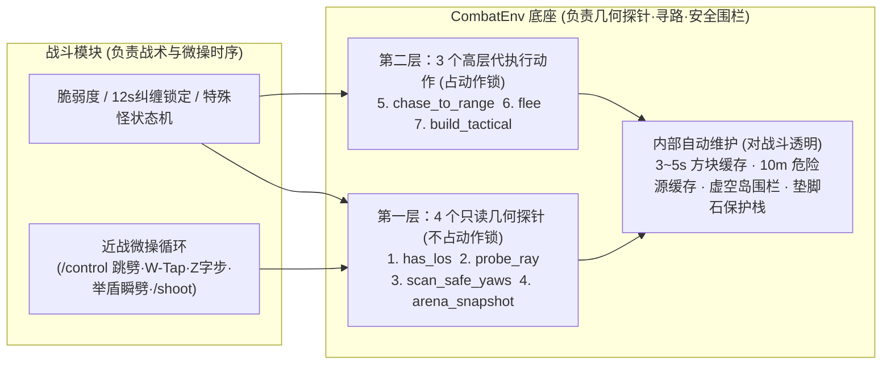

# 战斗模块与空间移动底座接口契约（`CombatEnv` 规范 v1）

> 适用范围：`mc-agent` 战斗子系统（`skills/combat.py`）与空间/移动底座（`skills/combat_env.py`）协同对接  
> 对接基线：`mc-agent-api v1.3.14`、现有微操实测脚本 `run_combat_tests.py` 与战斗设计稿 `docs/战斗fight(1).txt`

---

## 1. 对接原则与职责边界

为保证现有微操成果零损耗迁移到真实野生地形（山地、森林、地下矿道、水边、虚空岛边缘及下界堡垒），同时避免重复建设重型地形寻路模块，双方按**「战术微操归战斗、几何探针与寻路工事归底座」**切分职责：

1. **`run_combat_tests.py` 已验证的核心机制原样保留**：
   - 本地武器攻击冷却估算器（`weapon_cooldown_s` / `melee_ready_in` / `melee_control`）；
   - 苦力怕受阻/失速锁盾状态机（`CreeperEscapeWatch` + `shield_latched`）；
   - 弹道感知突进与极窄松盾出刀窗（`RushGuard` + `action_shield_duel`）；
   - 双阶段下落跳劈暴击（`action_jump_crit`）、W-Tap 击退斩、Z 字折线步、半身缝隙修脚（`action_gap_slash`）等微操原语。
2. **客观接口约束与性能红线**：
   - **0 大模型上下文开销**：所有战斗空间感知均在 Python 层毫秒级闭环，不暴露新微操 Tool 给 LLM，不消耗 30 RPM 请求配额。
   - **不做全量体素网格扫描、不写长期地形记忆**：`mc-agent-api` 无批量三维体素接口，单次 `POST /get_block` 约 `10~50ms`；因此不做数百格的局部建图，也不把瞬态战斗地形写入持久化 `WorldMemory`。
   - **读写分离设计**：近战 `< 5m` 微操阶段，底座仅通过 **4 个无锁只读几何探针**（单次耗时 `< 60ms`）提供视线、坡度跳跃标志与安全偏角，**`/control`、`/look`、`/posture` 的毫秒级控制权 100% 留在战斗模块手中**；远距绕障追击、战略脱离与放块掩体则通过 **3 个高层代执行接口**交由底座包办。



---

## 2. `CombatEnv` 初始化与共享约定

底座提供统一环境实例，屏蔽底层方块缓存、环境危险源刷新、物品保护栈与虚空岛电子围栏参数：

```python
env = CombatEnv(bot, skills=macro_skills, geofence=void_geofence)
```

- **客户端兼容**：底座 `BotSession` 与 `run_combat_tests.py` 的 `SimpleBotClient` 调用习惯对齐（支持 `bot.status()`、`bot.inventory()` 及统一的 `bot.call("control", ...)` / `bot.call("posture", ...)` / `bot.call("look", ...)`）。
- **缓存生命周期（内部全自动）**：
  - `block_cache`：同坐标方块查询缓存 `3.0s`（当调用 `build_tactical` 或检测到爆炸事件时自动失效局部缓存）；
  - `hazard_cache`：周围 `10m` 内危险方块（`lava`、`fire`、`soul_fire`、`magma_block`、`water`、`cactus`、`sweet_berry_bush`、`powder_snow`、`cobweb`）通过单次无锁 `/find_blocks` 缓存 `3.0s`。

---

## 3. 第一层：4 个纯只读几何探针（0 动作锁占用）

供战斗模块在任意循环帧内查询几何事实，自行拼装 `/control`（含同帧移动+挥刀、Z 字变向、横向绕柱、举盾微调等）。

### 接口 1：`env.has_los(src_pos, dst_pos, *, src_eye=1.62, dst_height=1.0) -> dict`
用于判断两点之间视线/弹道是否畅通（最多抽样连线上 `3~12` 格，命中缓存时 `0` HTTP 请求）。

- **输入**：`src_pos: [x, y, z]`，`dst_pos: [x, y, z]`（可选自定义眼高，如潜行修脚传 `src_eye=1.27, dst_height=0.35`）。
- **返回**：
  ```python
  {
      "clear": True,                 # True 表示无实心方块阻挡视线/箭矢
      "blocker": None,               # 若被挡，返回 {"name": "stone", "pos": [x, y, z], "dist": 2.4}
  }
  ```
- **典型战斗用途**：
  1. 过滤 `get_entities` 球形雷达扫出的**隔壁矿道/脚下溶洞隔墙假威胁**（替掉裸 `nearest_hostile_entity`）；
  2. 远程 `/shoot` 开弓前确认不被树干/石柱挡箭；
  3. **找掩体死角**：测试左/右横移 1~2 格后的候选点 `P'` 对骷髅是否 `clear == False`，实现躲柱后卡视野引骷髅近身。

---

### 接口 2：`env.probe_ray(origin, yaw, *, dist=3.0) -> dict`
**万能单向探路尺**。给定起点与任意水平偏航角 `yaw`（弧度，与 `/control`、`/look` 坐标系完全一致），沿线检测前方 `1.0m ~ dist` 的通行性与脚下地形。

- **输入**：`origin: [x, y, z]`，`yaw: float`，`dist: float = 3.0`。
- **返回**：
  ```python
  {
      "safe": True,                  # 综合判定：不撞墙、无致命危险方块、不坠崖、不越虚空围栏
      "walkable_flat": False,        # 不按跳跃能否直接平走通过
      "needs_jump": True,            # 前方为 1 格高可跨台阶且头顶净空（在 /control 中加 jump=True 即可上坡！）
      "blocked_by_wall": False,      # 前方 >=2 格高实心阻挡或头顶卡死
      "max_drop": 0,                 # 沿线脚下最大下坠格数（>=4 视为 cliff 危险）
      "hazard": None,                # None | "lava" | "cliff" | "water" | "fire" | "trap" | "geofence" | "wall"
      "safe_dist": 3.0,              # 在遇到首个障碍/危险前最多可安全移动的米数
  }
  ```
- **典型战斗用途**：
  1. **`action_shield_duel` / `rush` 突进**：发 `/control(forward=True)` 前测一下朝目标的 `yaw`——若 `needs_jump=True` 则顺手带上 `"jump": True`（解决野外 1 格土坡卡死）；若 `hazard in ("lava", "cliff")` 则立刻停步切弓箭，绝不冲进岩浆沟；
  2. **Z 字折线（`±32°`）/ 横向绕柱（`±90°`）/ 劫掠兽侧闪**：发斜向脉冲前测一眼左斜与右斜哪个 `safe=True`，自由决定转向哪一侧。

---

### 接口 3：`env.scan_safe_yaws(origin, preferred_yaw, *, dist=3.0, angles_deg=(0, 35, -35, 70, -70, 110, -110, 150, -150)) -> dict`
围绕期望方向做扇面快速扫描，按“安全可达优先 + 偏离期望角最小优先”排好序返回。

- **输入**：`origin: [x, y, z]`，`preferred_yaw: float`（如背离苦力怕的 `away_yaw`），`dist: float = 3.0`。
- **返回**：
  ```python
  {
      "best_yaw": 1.82,              # 最优安全偏航角（若全方向均为绝壁/岩浆则为 None）
      "best_needs_jump": False,      # 走 best_yaw 是否需要带 jump=True
      "cornered": False,             # True 表示所有候选方向均不可退（可直接触发锁盾硬接！）
      "candidates": [                # 全量候选结果，供多怪夹击时结合其他怪物方位二次挑选
          {"yaw": 1.82, "offset_deg": 35, "safe": True, "needs_jump": False, "safe_dist": 3.0, "hazard": None},
          ...
      ],
  }
  ```
- **典型战斗用途**：
  - 直接替换 `action_kite_creeper` 中的直线 `away_yaw`：背后有树自动偏 `35°` 绕开，背后是悬崖/岩浆自动换向；若 `cornered == True`，直接无缝切入现有的 `phase = "guard"` 锁盾分支。

---

### 接口 4：`env.arena_snapshot(pos, *, target_pos=None, hazard_radius=10) -> dict`
一次性获取当前站位的局部封闭结构、头顶可垫高度、周围环境陷阱及目标脚下地形。

- **输入**：`pos: [x, y, z]`，可选 `target_pos: [x, y, z]`。
- **返回**：
  ```python
  {
      "enclosure": "carved_shaft",   # "sealed_bunker" | "carved_shaft" | "open_cave" | "surface" | "unknown"
      "open_dirs": ["north", "south"],
      "solid_wall_dirs": ["east", "west"],
      "max_pillar_height": 0,        # 当前位置头顶净空允许原地垫高几格 (0 ~ 3)
      "in_water_or_lava": False,
      "hazards": [                   # 周围 10m 内的岩浆/火/水/浆果丛/仙人掌/细雪/蛛网
          {"name": "lava", "pos": [812, 119, 805], "dist": 4.2},
      ],
      "target_over_hazard": False,   # target_pos 正下方是否为岩浆或 >=5 格深渊（防烈焰棒等战利品掉岩浆/悬崖！）
  }
  ```
- **典型战斗用途**：
  1. `pillar` 前看 `max_pillar_height >= 2` 再起跳，避免在矿洞或树下撞头白挨打；
  2. 矿道遇怪（`enclosure == "carved_shaft"`）直接切入半身封口修脚 `action_gap_slash` 或封墙；
  3. 打烈焰人残血时看 `target_over_hazard`：若它正悬停在岩浆海/深渊外，先举盾等它靠近桥面再补最后一刀。

---

## 4. 第二层：3 个高层代执行动作（占用动作锁）

当距离较远（`> 5m`）、隔着复杂障碍直线过不去，或判定撤退/搭工事时，直接调用底座现成封装，战斗模块无需编写寻路与背包筛石逻辑。

### 接口 5：`env.chase_to_range(target, *, range_m=2.5, timeout_ms=1200, stop_on=("death",)) -> dict`
借服务端 Mineflayer 内存级 A\* 寻路器绕树、爬坡、过拐角贴近目标。

- **输入**：`target` 可传 `entity_id: int` 或坐标 `[x, y, z]`；短脉冲 `timeout_ms` 默认 `1200ms` 便于高频重观察。
- **返回**：`{"ok": bool, "dist_after": float, "pos_after": [x,y,z], "reason": "reached" | "timeout" | "path_not_found" | "geofence_blocked"}`。

---

### 接口 6：`env.flee(threat_pos=None, *, distance=14.0, urgent=True, allow_shaft_seal=True) -> dict`
当脆弱度判定打不过、遇高危生物（坚守者/猪灵蛮兵/群怪）或残血需彻底脱离战场时调用。

- **内部自动完成**：若在自建窄巷且 `allow_shaft_seal=True` 优先 2 块石头封死威胁侧；否则执行「前 1s 安全角防坠疾跑冲刺 + 后段 Mineflayer 寻路脱离 + 涉水防沉浮泳 + 虚空岛围栏保护」。
- **返回**：`{"ok": bool, "mode": "sealed" | "flee" | "respawned", "moved_dist": float, "pos_after": [x,y,z]}`。

---

### 接口 7：`env.build_tactical(mode, *, direction=None, height=2) -> dict`
战术方块小工事执行器（内部自动从背包挑选非保护垫脚废石，严禁误用工作台/箱子/矿块）。

- **支持模式 `mode`**：
  - `"pillar"`：先校验 `max_pillar_height >= height`，再执行原地跳垫高 `2` 或 `3` 格；
  - `"half_seal"`：在指定 `direction`（如 `"north"`）放置上半格阻挡块，留出脚部 1 格缝隙供 `action_gap_slash(mode="foot")` 无伤修脚；
  - `"full_seal"`：将指定方向的 `1×2` 通道口完整封死；
  - `"cover_pocket"`：露天/大洞挨远程箭矢且贴近岩壁时，向岩壁快速掏入并封口躲避。
- **返回**：`{"ok": bool, "mode": str, "placed": int, "pos_after": [x,y,z], "reason": str | None}`。

---

## 5. 进出战斗的锁交接与状态清理约定

为确保战斗模块嵌入主循环（`GenerationGuard` 自动防御 & `mc_attack` 主动狩猎）后不与挖矿/赶路状态打架，双方遵守以下进出边界：

1. **接管入口**：触发战斗前，由外层调用方或战斗入口先执行无锁 `POST /stop` 释放正在运行的寻路/挖掘锁。
2. **退出清理（重要）**：
   - 在独立靶场脚本中，`action_shield_duel` 等在 `finally` 里保留了 `posture(shield=True)`；
   - **合入主仓 `skills/combat.py` 后**，当目标已击杀、已安全脱离（`flee` 成功）或战斗正常结束返回主循环时，**必须统一复位持续姿态与按键**（释放 `control(wait=False)` 与 `posture({})`），避免后续 Bot 一直卡在举盾/潜行慢走状态；仅当返回值显式标记 `latched_guard=True`（如被逼死角正举盾等苦力怕引爆的瞬间）才短暂保留举盾并在爆炸后释放。
3. **嘎吱（Creaking）等特殊方块联动**：
   - 若后续实现嘎吱博弈，检测到 `creaking` 无敌受击后，可直接调 `/find_blocks(types=["creaking_heart"], radius=32)` 定位嘎吱之心坐标并交由 `/dig` 破坏，无需额外新接口。

---

## 6. 对接确认清单（供战斗同学核对）

请对照你手头的 `run_combat_tests.py` 与后续 `战斗fight(1).txt` 计划，确认以下 3 点：
1. 上述 **「4 个只读探针 + 3 个高层代执行」** 是否已覆盖你全部近战拉扯、远程对射、掩体卡视野与特殊怪走位场景？有无遗漏字段？
2. `probe_ray` 与 `scan_safe_yaws` 使用的 `yaw` 弧度制（`math.atan2(-dx, -dz)`，与 `aim_angles` 完全同系）是否与你当前代码无缝匹配？
3. 确认无误后，底座组先交付带单测的 `src/mc_agent/skills/combat_env.py`，你可直接在现有函数上替换靶场直线走位完成合入。
