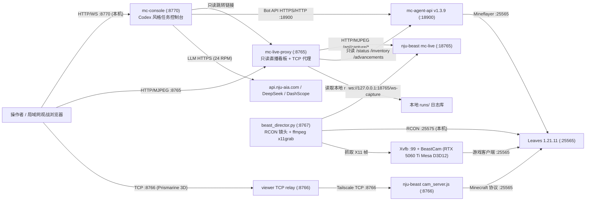

# `mc-agent` 全栈架构、常驻运维与实机修复完整归档（2026-11-15）

> [!NOTE]
> 本文档汇总截止 `2026-11-15` 的完整系统架构、多机端口拓扑、`systemd --user` 与 `nju-beast` 常驻后台运维方案、Codex 风格控制台 `mc-console`、全部真机生存与监控工程修复细节，以及 `agy`/`agyp` 官方终端沙箱配置参考。所有敏感配置（`.env.beast`、`.state-beast/tokens.json`）均保持 `0600` 受限存储，不在本文档中留存任何密码、密钥或 Bearer Token。

---

## 1. 系统总体架构与端口拓扑

整个系统由 **本机工作站（Arch Linux `/home/xzq/projects/mc`）** 与 **远端渲染/测试服务端（`nju-beast`，Tailscale `100.93.211.71` / WSL2 `Ubuntu-22.04`）** 两部分组成，此外兼容校园网测试服 `5ease` 与官方比赛环境 `apiin`：



### 1.1 各节点与端口一览表

| 节点 | 服务 / 守护单元 | 绑定地址与端口 | 职责与说明 | 所属配置 / 代码 |
|---|---|---|---|---|
| **本机 (Arch Linux)** | `mc-live-proxy.service` | `0.0.0.0:8765`<br/>`0.0.0.0:8766` | `mc-live` 代理前端 + 局域网可访实时/回放看板；内置 Prismarine TCP 中继将本机 `:8766` 转发至 `100.93.211.71:8766` | [`deploy/systemd/mc-live-proxy.service`](../deploy/systemd/mc-live-proxy.service)<br/>[`src/mc_agent/live/server.py`](../src/mc_agent/live/server.py) |
| **本机 (Arch Linux)** | `mc-console.service` | `127.0.0.1:8770` | Codex 风格 Web 控制台（单轮/多轮对话、队列与 `/now` 紧急插队、安全停止、遥测侧边栏） | [`deploy/systemd/mc-console.service`](../deploy/systemd/mc-console.service)<br/>[`src/mc_agent/console/server.py`](../src/mc_agent/console/server.py) |
| **`nju-beast` WSL2** | Leaves `1.21.11` | `25565`（游戏）<br/>`127.0.0.1:25575`（RCON） | 离线模式仿赛服务端（`online-mode=false`、`allow-flight=true`、`send_command_feedback false`） | `/home/xia/mc-beast/leaves/` |
| **`nju-beast` WSL2** | `mc-agent-api` v1.3.9 | `0.0.0.0:18900` | HTTP/SSE Mineflayer 机器人控制后端 | `/home/xia/mc-beast/api/` |
| **`nju-beast` WSL2** | `Xvfb :99` + `BeastCam` | 本地 `:99` + 连接 `:25565` | 无头 `1280x720` Minecraft `1.21.11` 实景渲染端（Mesa D3D12 / RTX 5060 Ti 硬件加速） | `/home/xia/mc-beast/client/` |
| **`nju-beast` WSL2** | `beast_director.py` | `127.0.0.1:8767` | RCON 镜头导演（`first_person` / `third_person`）+ `ffmpeg x11grab` MJPEG 推流至 `:18765` | [`live_viewer/beast_director.py`](../live_viewer/beast_director.py) |
| **`nju-beast` WSL2** | `cam_server.js` | `0.0.0.0:8766` | Prismarine WebGL `1.21.11 -> 1.21.4` 重映射备选 3D 旁观流（`LiveCam_01`） | [`live_viewer/cam_server.js`](../live_viewer/cam_server.js) |
| **`nju-beast` WSL2** | `mc-live`（上游） | `0.0.0.0:18765` | 上游实景推流接收与看板节点（避让宿主 WSL2 容器占用的 `:8765`） | [`src/mc_agent/live/server.py`](../src/mc_agent/live/server.py) |

> [!IMPORTANT]
> **单 Token 互斥原则**：`mc-agent-api` 对同一 Bot 执行 `POST /auth/login` 会吊销此前全部旧 Token。当前本机 `.state-beast/tokens.json` 与 `nju-beast` 上的 `/home/xia/mc-beast/.state-beast/tokens.json` 共享 `BeastBot_01` 会话 Token（`0600`），运行时只读探活复用，**切勿无故执行 `mc-bot login BeastBot_01`**。

---

## 2. 常驻后台服务部署与运维指南

所有长期后台服务均已与终端 AI 窗口（`agy` / `agyp`）彻底解耦：本机由宿主 `systemd --user` 托管，远端由 `nju-beast` 上独立的 WSL2 后台守护托管。

### 2.1 本机 `systemd --user` 统一运维（[`scripts/mc_services.sh`](../scripts/mc_services.sh)）

两个本机服务单元已源码化保存在仓库 [`deploy/systemd/`](../deploy/systemd/) 下：
- [`mc-live-proxy.service`](../deploy/systemd/mc-live-proxy.service)：直接执行 `/home/xzq/projects/mc/.venv/bin/mc-live`，监听 `0.0.0.0:8765` 与 `0.0.0.0:8766`，失效自动在 3 秒后拉起。
- [`mc-console.service`](../deploy/systemd/mc-console.service)：直接执行 `/home/xzq/projects/mc/.venv/bin/mc-console`，监听 `127.0.0.1:8770`，依赖 `mc-live-proxy.service`，绑定 `--bot BeastBot_01 --provider nju`。

日常常用操作：

```bash
# 1. 安装/更新两个服务单元到 ~/.config/systemd/user/ 并开机(登录)自启
bash /home/xzq/projects/mc/scripts/mc_services.sh install

# 2. 查看 systemd 运行状态及 :8765 / :8770 HTTP 健康探活
bash /home/xzq/projects/mc/scripts/mc_services.sh status

# 3. 启停与重启（例如修改了代码或 static 前端之后）
bash /home/xzq/projects/mc/scripts/mc_services.sh restart
bash /home/xzq/projects/mc/scripts/mc_services.sh stop
bash /home/xzq/projects/mc/scripts/mc_services.sh start

# 4. 查看最近 N 行服务日志（默认 60 行）
bash /home/xzq/projects/mc/scripts/mc_services.sh logs 120
```

> [!TIP]
> 若希望本机彻底退出桌面会话（Logout）后后台服务仍保持运行，可在常规终端执行一次 `sudo loginctl enable-linger xzq` 开启用户级常驻 linger。在当前 Arch Linux 桌面会话内，`systemd --user` 默认已随时保持存活，与终端窗口、VS Code 或 `agy` 是否关闭无关。

### 2.2 `nju-beast` 远端服务运维

`nju-beast` 侧的服务本身运行在其 Windows/WSL2 环境中，与本机 CLI 完全独立，可通过本机脚本一条命令查看或重启其渲染与看板组件：

```bash
# 查看 Leaves / mc-agent-api / Xvfb+BeastCam / cam_server / mc-live / beast_director 状态
bash /home/xzq/projects/mc/scripts/mc_services.sh beast-status

# 在 nju-beast 上重启 cam_server.js / mc-live / beast_director.py
bash /home/xzq/projects/mc/scripts/mc_services.sh beast-restart
```

详细的多进程端口与 `Xvfb :99` 环境部署说明见 [`live_viewer/BEAST_SETUP.md`](../live_viewer/BEAST_SETUP.md)。

### 2.3 同局域网同学只读旁观方法

1. `mc-live-proxy.service` 已绑定 **`0.0.0.0:8765`**（主界面与实景 MJPEG 流）与 **`0.0.0.0:8766`**（Prismarine WebGL 3D 备选端口）；而拥有写控制权限的 `mc-console.service` 仅监听 **`127.0.0.1:8770`**，从而天然隔离控制面与只读旁观面。
2. 同局域网或同一 Tailnet 下的同学只需在浏览器访问：
   - 局域网地址：`http://<本机局域网IP>:8765/`
   - Tailscale 地址：`http://<本机Tailscale_IP>:8765/`
3. 若本机 Arch Linux 启用了 `ufw` / `firewalld`，放行只读端口即可：
   ```bash
   # firewalld 示例：
   sudo firewall-cmd --add-port=8765/tcp --add-port=8766/tcp
   ```
4. [`src/mc_agent/live/static/app.js`](../src/mc_agent/live/static/app.js#L2274-L2278) 在打开「🟢 Prismarine 备选 3D」时会自动识别配置中的回环地址 `127.0.0.1` 并动态替换为当前页面的 `window.location.hostname`，确保局域网同学也能直接加载本机 `:8766` 转发出的 3D 画面；实景视图支持顶栏 **「👁 第一视角 / 🎥 第三视角」** 切换与右上角 **「👁 叠加层」** 一键隐藏角落 UI/受伤提醒卡片。

---

## 3. Codex 风格 Web 控制台（`mc-console`）

位于 [`src/mc_agent/console/`](../src/mc_agent/console/)，旨在替代命令行交互，提供类似 Codex 对话流体验的任务控制台（默认地址 `http://127.0.0.1:8770`）。

### 3.1 架构亮点

- **长会话与 KV Cache 复用**：`ConsoleController`（[`src/mc_agent/console/server.py`](../src/mc_agent/console/server.py#L244)）在服务端生命周期内持久复用单个 `BotSession` 与按 `(provider, enable_thinking, max_tokens)` 缓存的 `OpenAICompatibleChatModel` 实例；多轮下发任务时通过 `_history_summaries` 注入上一回合精炼摘要，避免每条消息重新冷启动与重复 `/events` 回放。
- **双模式实时插队**：任务执行期间继续在底部输入框发消息：
  - 普通提交 / 排队（默认 `Enter`）：在安全工具边界注入 `InputInbox`；
  - 紧急插队（`Ctrl/Cmd+Enter` 或点击「紧急插队」按钮，`immediate: true`）：设置高优先级标记并触发中断重规划，待交付答案若已过时将收到 `output.superseded` 事件重算。
- **全量实时追踪与录像留痕**：每轮通过 WebSocket `/ws` 流式推送模型文本增量、参数折叠与展开的工具调用卡片、运行耗时、结果成功/失败着色及状态侧边栏（血量、饱食度、氧气、位置、就绪状态与背包），同时将完整结构化事件写入 `runs/<timestamp>.events.jsonl`，直接在 `:8765` 的 `mc-live` 复盘页可读。

### 3.2 API 路由清单（源码已验证）

| 方法与路径 | 用途 | 核心请求体 / 行为 |
|---|---|---|
| `GET /` | 返回单页 Web 控制台 | 载入 [`static/index.html`](../src/mc_agent/console/static/index.html) |
| `GET /api/state` | 获取全量初始快照 | 返回 `config`、`telemetry`、`turns`、`active_turn_id` |
| `POST /api/command` | 下发新任务，或在运行中排队/紧急插队 | JSON: `text`, `immediate` (bool), `provider`, `max_calls`, `enable_thinking` |
| `POST /api/stop` | 协作式安全停止当前任务 | 触发 `stop_event` (`stop_check`)，在当前检查点优雅结束回合 |
| `POST /api/clear` | 清空界面对话历史与摘要缓存 | 空闲时可用，保留底层在线 `BotSession` |
| `POST /api/reconnect` | 断开并重新接入 Bot | 当 Bot 掉线或未就绪时手动重连并刷新遥测 |
| `GET /ws` | 实时事件与遥测 WebSocket | 推送 `snapshot`、`telemetry`、`turn_started`、`turn_item_upsert`、`turn_item_delta`、`turn_meta`、`turn_finished` |

> 安全保护：非 `--allow-lan` 模式下，所有写操作与 WebSocket 连接通过 `_check_origin` 严格校验来源仅限 `127.0.0.1` / `localhost` / `[::1]`，防止跨站请求伪造。

---

## 4. 真机生存与监控工程修复全记录（2026-11-14 至 2026-11-15）

除前期 [`docs/expedition-20261114.md`](expedition-20261114.md) 已归档的 7 项核心修复外，在 `nju-beast` 联合 `mc-live` + `mc-console` 真机生存压测期间，针对水坑死循环、历史事件幻觉、隔墙怪物恐慌、空手碎矿及狭小气室熔炼等顽疾完成了以下 6 项深层工程修复，并均由单测与真机运行日志验证：

| # | 暴露问题与现象 | 根本原因分析 | 修复方案与代码位置 | 验证结果与证据 |
|---|---|---|---|---|
| **1** | Bot 掉入矿洞浅水/深坑后不会上浮、不断窒息或原地乱转无法上岸 | `mc-agent-api` 氧气值满值为 **`300` ticks**（原代码按 `<= 16` 判断）；且计算朝向岸边 `yaw` 时公式与 Mineflayer `forward=(-sin(yaw), -cos(yaw))` 符号相反 | 1. [`safety.py`](../src/mc_agent/skills/safety.py#L66) `check_and_stabilize` 改在 `in_water` 且 `(submerged or not on_ground or oxygen < 240)` 时激活 `posture(jump=True)`；<br/>2. [`library.py`](../src/mc_agent/skills/library.py#L220) 新增 `_yaw_toward` 修正为 `atan2(-dx, -dz)` 并实现 `escape_water()`（L904）：上浮至水面 `wy`，先掘开岸上方 `(wy+1, wy+2)` 石头悬崖但不破坏 `(ex, wy, ez)` 岸基，跳跃登岸并归零 `posture(jump=False)`，集成进 `unstick()`（L1152） | 单测覆盖；真机 [`20261114-215952-746458.events.jsonl`](../runs/20261114-215952-746458.events.jsonl) `seq 41` 一次 `mc_skill_unstick` 掘开石室悬崖并从 `[-167.3, 62.2, -392.7]` 登岸至 `[-166.3, 63, -392.1]`（`escaped_water: true`） |
| **2** | 身处水中强行挖矿触发 `25x` 慢速惩罚与 `interrupted` 并反复重试同一方块 | 未跳过上方/四周邻水方块，且被 `/dig` 中断后未将该坐标列入失败黑名单 | [`library.py`](../src/mc_agent/skills/library.py#L237) `_is_water_covered` 与 `mine_blocks()`（L684）：开挖前若 `in_water` 先逃离水面、默认过滤邻水矿石，并将返回 `"interrupted"` 的方块加入局部黑名单；[`agent.py`](../src/mc_agent/harness/agent.py#L26) `MC_SYSTEM_PROMPT` 强化铁律 | 单测 `test_water_escape_and_underwater_mining_protection` 通过 |
| **3** | 新任务首轮常产生“刚死亡、背包被清空、还在挨打”的严重幻觉 | `McToolset` 默认从 `seq=0` 仅拉单页 `limit=50`，当历史 `/events` 超过 50 条时，旧 `[受伤]`/`[死亡]` 会在开局或前几轮逐步回放进 `[期间新事件]` | [`mc_tools.py`](../src/mc_agent/harness/mc_tools.py#L329) 新增分页 `sync_event_cursor()`（`max_pages=20`）并在 `BotSession` 上持久化 `_last_event_seq`；`drain_notable_events()`（L357）多页追平并过滤 `BeastBot_01` 自身系统聊天广播；[`agent.py`](../src/mc_agent/harness/agent.py) 开局即同步游标 | 单测 `test_event_cursor_pagination_wall_los_and_dig_tier_guard` 通过；真机 [`20261114-221303-117116.events.jsonl`](../runs/20261114-221303-117116.events.jsonl) 开局零虚假死亡/受伤幻觉 |
| **4** | 在地下干燥安全气室中因附近 15~25 格有隔墙怪物而恐慌强行逃向危险地表 | `mc_status` 仅按三维欧氏距离计算 `nearest_hostile`，无法区分实体是否隔着整堵石墙，且缺少所在空间闭合度感知 | [`mc_tools.py`](../src/mc_agent/harness/mc_tools.py#L83) `_ray_wall_blocker()` 三维射线步进检测 + `_enrich_status_awareness()`（L124）为 `mc_status` 注入 `enclosure`（`roofed_pocket` 等）和 `threat_assessment.hostile_blocked_by_wall`，为 `mc_get_entities` 标注 `blocked_by_wall`；同步升级 `MC_SYSTEM_PROMPT` | 真机 [`20261114-221303-117116.events.jsonl`](../runs/20261114-221303-117116.events.jsonl) `seq 71` 精准标出多只怪 `blocked_by_wall: true`，`seq 129` 模型明确输出“怪物均被墙体阻隔无法攻击……再就地挖矿熔炼” |
| **5** | 模型直接调用底层原子工具 `mc_dig` 空手挖碎 `iron_ore` 导致颗粒无收 | 此前仅 `mine_blocks` 检查工具等级，直接 `mc_dig` 无保护 | [`mc_tools.py`](../src/mc_agent/harness/mc_tools.py#L452) `mc_dig()` 接入 `BLOCK_MIN_PICKAXE_TIER` 校验与 `_best_pickaxe_in_inv()` 自动切镐，无达标镐时直接返回结构化拒挖报错，保护矿块不被手挖损毁 | 单测 `test_event_cursor_pagination_wall_los_and_dig_tier_guard` 验证通过 |
| **6** | 在狭小 1x2 矿洞或石室气室内放置熔炉（`furnace`）失败无法烧铁 | 原 `_carve_and_place_table` 仅支持 `crafting_table`，`smelt_items` 缺狭小空间掏墙龛逻辑 | 泛化 [`_carve_and_place_table(..., item=...)`](../src/mc_agent/skills/library.py#L292)，并在 [`smelt_items()`](../src/mc_agent/skills/library.py#L744) 引入三级放置回退（自动放置 -> 周边四方向贴靠 -> 掏出墙体壁龛后放置） | 已纳入现有单元测试与 [`src/mc_agent/skills/library.py`](../src/mc_agent/skills/library.py) |

### 4.1 单元测试与当前实测已知边界

- **本地自动化测试**：`uv run --offline pytest -v` 覆盖 [`tests/`](../tests/) 下 5 个测试文件共 **41 项测试用例**（涵盖认证与 Bot 管理、Harness 调度与文本工具兜底、L0 守护与水中脱困/矿镐守卫/射线遮挡、实时看板与代理路由、`mc-console` WebSocket 与控制面安全校验）。
- **最新实测（[`20261114-221303-117116.events.jsonl`](../runs/20261114-221303-117116.events.jsonl)）观察到的剩余可优化点**：
  - Bot 从 `Y=62` 地下气室通过 `mc_skill_staircase(vertical='up')` 成功回到地表 `Y=74`（`seq 133`, `stop_reason: "reached_surface"`）；
  - 随后调用 `mc_skill_harvest_logs(radius=32)` 因周边树干树桩部分触发服务器保护区机制返回 `ok: false, protected_blacklisted: 18`（`seq 171`），模型转而自行 `mc_move_to` + `mc_dig` 成功手砍 3 个 `birch_log`（`seq 407`、`seq 447`、`seq 521`），最终因 `600.0s` 单次运行上限结束，说明 `harvest_logs` 对部分近保护区树干的可达位置探索仍可进一步扩大搜索半径与白桦偏好排序。

---

## 5. 代码仓库与关键产物目录索引

| 路径 | 说明 |
|---|---|
| [`AGENTS.md`](../AGENTS.md) | 项目级 Agent 规范（含沙箱边界与单 Token 约束） |
| [`README.md`](../README.md) | 项目总入口与四大 CLI 快速指南 |
| [`pyproject.toml`](../pyproject.toml) | 依赖管理与 `mc-bot` / `mc-harness` / `mc-live` / `mc-console` 入口 |
| [`deploy/systemd/`](../deploy/systemd/) | 本机常驻 `systemd --user` 单元（`mc-live-proxy.service`、`mc-console.service`） |
| [`scripts/mc_services.sh`](../scripts/mc_services.sh) | 本机 + 远端 `nju-beast` 服务一键启停/状态/日志管理脚本 |
| [`src/mc_agent/bot.py`](../src/mc_agent/bot.py) / [`auth.py`](../src/mc_agent/auth.py) / [`config.py`](../src/mc_agent/config.py) | 账号会话、Token 复用与代理绕过核心（已涵盖私网与 Tailscale `100.64.0.0/10`） |
| [`src/mc_agent/harness/`](../src/mc_agent/harness/) | Harness 主循环、`MC_SYSTEM_PROMPT`、`mc_tools.py`（游标追平/墙体射线/工具等级守卫）与流式事件记录 |
| [`src/mc_agent/skills/`](../src/mc_agent/skills/) | `safety.py`（L0 保命与水下浮力）、`library.py`（水域逃生/挖矿/阶梯/掏龛冶炼/脱困）、`advancements.py` |
| [`src/mc_agent/kb/`](../src/mc_agent/kb/) & [`src/mc_agent/data/`](../src/mc_agent/data/) | `1.21.11` 零膨胀知识底座与 125 项原版进度目录 |
| [`src/mc_agent/live/`](../src/mc_agent/live/) | `mc-live` 后端与前端（实景流、Prismarine 转发、AI 体素 3D、自由鸟瞰、2D 雷达、叠加层开关与日志复盘） |
| [`src/mc_agent/console/`](../src/mc_agent/console/) | `mc-console` Codex 风格交互控制台前后端 |
| [`live_viewer/`](../live_viewer/) | `nju-beast` 侧 `beast_ctl.py`、`beast_director.py`、`cam_server.js` 与 [`BEAST_SETUP.md`](../live_viewer/BEAST_SETUP.md) |
| [`docs/expedition-20261114.md`](expedition-20261114.md) | 前期双模型对比与 `5Ease_Bot` 分阶段压测报告 |
| [`runs/`](../runs/) | 结构化运行日志（如 `20261114-215952-746458.events.jsonl` 脱困验证、`20261114-221303-117116.events.jsonl` 隔墙与升地表验证） |

---

## 6. 关于 `agy` / `agyp` 官方终端沙箱的配置说明

当在 `agy` / `agyp` 中频繁看到 `127.0.0.1` 或 `ssh` 命令先在容器沙箱内报一次错，核心原因在于 Antigravity 默认使用 **Linux Namespace 终端沙箱**（会阻断沙箱内进程访问宿主机回环网络、Tailscale 和 `~/.ssh`）。如需**永久减少或关闭**这种沙箱拦截，可使用 Antigravity CLI **官方支持的设置项**（当前 `agyp` 会话真实宿主机配置文件位于 `/home/xzq/.config/agy/profiles/plus/.gemini/antigravity-cli/settings.json`，主账号位于 `/home/xzq/.gemini/antigravity-cli/settings.json`）：

1. **方案 A：精细放行常用宿主命令（保留沙箱防护，最稳妥）**  
   在 CLI 中输入 `/permissions` 或在 `settings.json` 的 `permissions.allow` 中为常用无状态指令（如 `bash /home/xzq/projects/mc/scripts/mc_services.sh`、`ssh`）添加规则，并在工作区 [`AGENTS.md`](../AGENTS.md) 约束 Agent 跳过沙箱试跑、直接请求 `BypassSandbox: true`。
2. **方案 B：按需或全局关闭终端沙箱（官方配置项）**  
   - 会话级关闭或切换模式：使用交互面板 `/config` 或 `/permissions` 调整权限预设；或在明确受信任环境单次启动时传 `--dangerously-skip-permissions`。
   - 配置文件关闭（`settings.json`）：将 `"enableTerminalSandbox"` 设为 `false`，同时把 `"toolPermission"` 设为 `"always-proceed"`（或 `"request-review"`），并将 `"agentMode"` 设为 `"accept-edits"`（或 `""`）。
   - **重要官方限制**：官方文档明确规定 `"agentMode": "auto"` **强依赖终端沙箱开启**；如果同时设置 `"enableTerminalSandbox": false`，CLI 会因无法满足 `auto` 模式前置条件而自动回落为标准询问模式，因此关闭沙箱时应同步将 `agentMode` 从 `"auto"` 改为 `"accept-edits"` 或 `""`。

---

## 7. 后续接手迭代（2026-11-14 本地会话）

本轮根据 `20261114-222403-099956.events.jsonl` 复盘后，修正了第 4 节隔墙感知中的过度安全结论：最近一只怪物的射线遮挡不能推导整体安全。现在 `mc_status` 最多检查 5 只近敌，保留未确认状态，不再通过射线给出 `safe_in_place=true`；提示词也同步约束。

同时补齐实时观测链：`run.started.initial_snapshot` 和独立 `mc.notable_events` 写入正在追加的 JSONL，mc-live 和控制台能在运行结束前展示；支持 API 的 `spawn` 事件。mc-live 首次接入先分页追平历史事件，避免大于单页的旧死亡/受伤被后续轮询当成新告警。

本轮原有可离线运行的 32 项测试和新增 10 项回归测试通过；9 项需要网络 socket 的集成测试受当前沙箱限制，尚待宿主验证。宿主侧服务探活请求遭会话权限策略拒绝，因此尚未重启或部署、未完成持续在线观测和实机验证。最新本地轨迹仍停在 22:31 的 `interrupted` 状态。完整证据、备份与下一轮检查见 [接手记录](takeover-20261114.md)。

---

## 8. NJU 铁镐任务在线基线（2026-11-15）

恢复宿主访问后，经常驻控制台实际执行 `20261115-145600-335360`：从空背包制作并装备铁镐，provider=`nju`。完整观察 600 秒，32 次模型请求、33 次工具调用，记录到 6 次死亡和 41 条受伤通知，最终超时、空背包，未制作出石镐或铁镐。已保存原始日志、完整报告、99 个补充遥测样本和实景截图。

首要问题为模型等待期间缺少持续保命、旧遮挡判断压过真实新伤害、重复遗漏材料前置、宏技能部分成功/受击失败没有提升为调度器可识别的恢复状态。运行进程仍加载前次修改前的代码，尚未部署重启。详细证据和改进顺序见 [本轮复盘](iron-pickaxe-observation-20261115.md)。

此前受沙箱限制的完整离线测试现已在宿主验证：`51 passed in 4.47s`。本轮未改运行代码、未人工插队、未重新登录 Bot、未启动下一轮任务。
